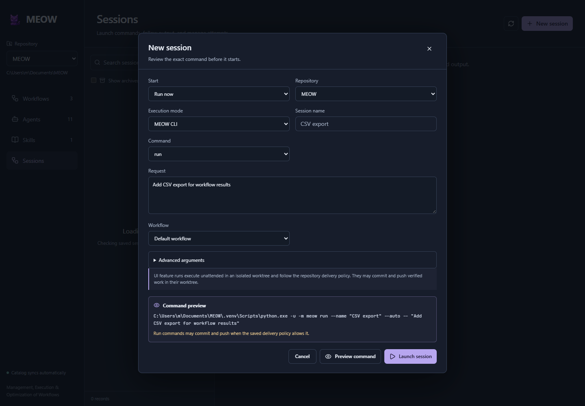

# MEOW

<p align="center">
  
</p>

> Tell MEOW what you want. Get the finished branch.

MEOW is a workflow harness for Claude that plans, implements, tests, reviews,
and delivers software changes in isolated worktrees.

Running a built-in workflow starts a loop: MEOW implements, reviews, and fixes
the work until review passes, or the configured round limit is reached. It does
not stop after a single attempt. Once review passes, MEOW runs the final checks
before delivery. Custom workflows control their own loop stages.

## Install

### PowerShell

```powershell
irm https://raw.githubusercontent.com/maya8237/MEOW/main/scripts/install.ps1 | iex
```

### Bash

```bash
curl -fsSL https://raw.githubusercontent.com/maya8237/MEOW/main/scripts/install.sh | sh
```

The installer downloads the latest published release into `~/.meow`, including
its Python runtime and Claude plugin. It adds `~/.meow/bin` to your user `PATH`;
no MEOW checkout, system Python, or package installation is needed. On Windows,
`~` is your user profile. Open a new terminal after installation if necessary.

Run `meow --update` or `meow -u` to install the latest published release.
Public commands and `/meow:*` skills warn when a newer release is available.
Use `-a` / `--auto` on feature runs for automatic execution.

## Run

Claude Code:

```text
/meow:run Add CSV export
```

Terminal or CI:

```bash
meow run "Add CSV export" --name csv-export
```

Projects are set up automatically on first use. Use `/meow:onboard` to configure
integrations and optional features.

To start a session in the browser, run `meow ui`, open **Sessions**, and choose
**New session**. Enter your request, preview the command, then select **Launch session**.



## Common commands

| Need | Command |
| --- | --- |
| Plan only | `/meow:plan ...` or `meow plan ...` |
| Run related tasks in parallel and deliver one PR | `/meow:orchestrate ...` or `meow orchestrate "Add SSO login and an admin audit log"` |
| [Schedule a run](docs/CLI.md#scheduling-a-run) | `/meow:schedule ...` or `meow schedule add --at "09:00" -- run "Add CSV export" --name csv-export` |
| Review | `/meow:review ...` or `meow review ...` |
| Integrate CI review | `/meow:integrate-ci-review` |
| Fix lint | `/meow:lint` |
| Queue work | `meow queue "..."` |
| Check or continue | `meow status` or `meow resume RUN_ID` |
| Browse definitions or manage command sessions | `meow ui` |

See the [CLI guide](docs/CLI.md) for worktrees, background runs, recovery,
orchestration, and advanced options.

## Configuration and integrations

- `.meow/config.toml` — shareable project settings.
- `.meow/config.local.toml` — ignored machine- or user-specific settings.
- `~/.meow/config.toml` — user fallback settings.

MEOW supports Jira, GitLab, GitHub, configured tests and builds, browser
tester checks, Claude Code hooks, and scheduled Jira runs. See the
[integration guide](docs/INTEGRATIONS.md).

## Docs

- [Architecture](docs/ARCHITECTURE.md)
- [CLI guide](docs/CLI.md)
- [Integrations](docs/INTEGRATIONS.md)
- [Project instructions](AGENTS.md)
- [Contributing](CONTRIBUTING.md)
- [Roadmap](docs/ROADMAP.md)
- [Changelog](CHANGELOG.md)
- [License](LICENSE)
